[**Open my interactive portfolio ↗**](https://salwyx.github.io/)

<a href="https://t.me/biden911">Let’s build at a hackathon ↗</a> · <a href="https://www.tiktok.com/@fastboot69">Progress on TikTok ↗</a>

Interested in <strong>AI Coding with Claude, ChatGPT and Google Antigravity</strong>, alongside React, TypeScript and Java 21.

 &nbsp;  &nbsp; 

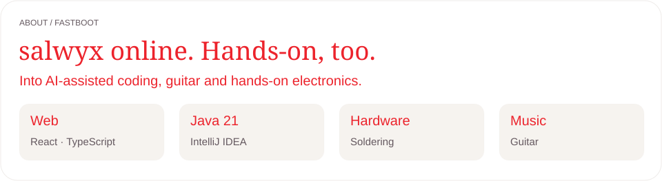

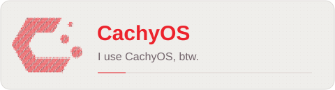

<a href="https://brianmay.com/brian-news/2020/10/how-the-red-special-got-its-name/">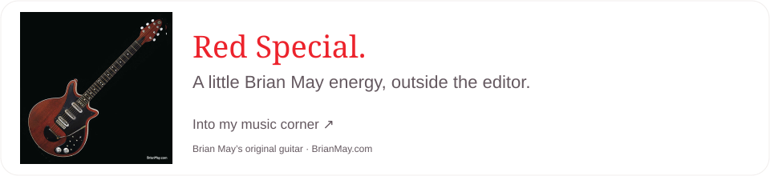</a>

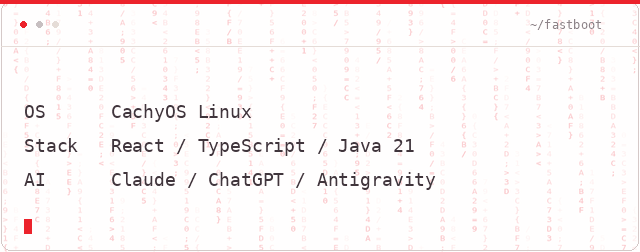

<table><tr><td width="45%"></td><td>

**I play guitar. I can solder.**

Some things are better built with your hands. Brian May gets his own corner here; my practice, experiments and progress go on TikTok.

[Follow my progress — @fastboot69 ↗](https://www.tiktok.com/@fastboot69)

</td></tr></table>

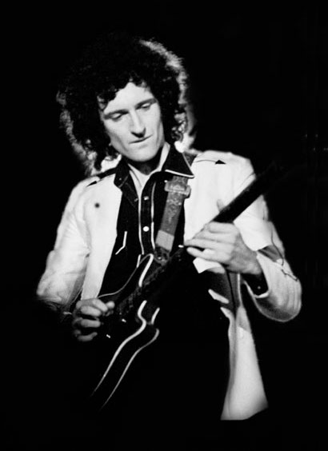 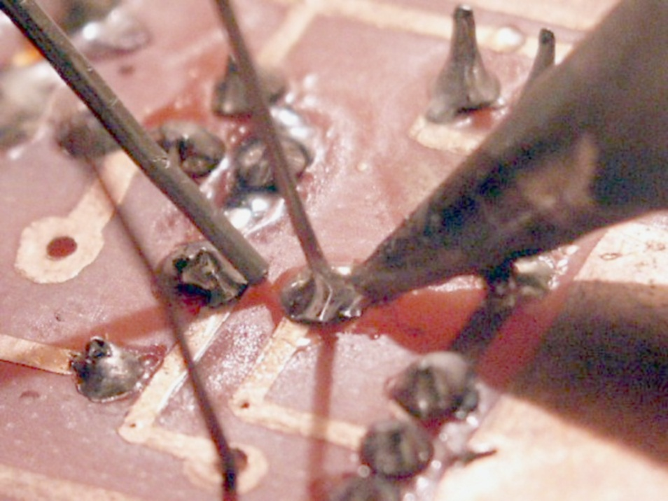

Photo credits

[Photo authors and licenses](PHOTO-CREDITS.md).

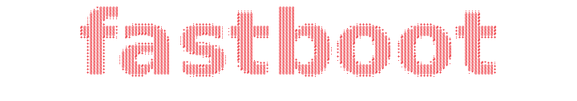

<strong>Design sample:</strong> this profile page is an example of my visual design — layout, typography, interaction and motion.

<a href="https://www.tiktok.com/@fastboot69">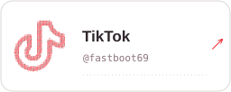</a>
<a href="https://t.me/biden911">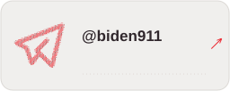</a>
<a href="https://www.youtube.com/@f4stb00t">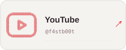</a>
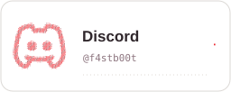

<a href="mailto:alikutubaev2005@gmail.com"><strong>Email — alikutubaev2005@gmail.com ↗</strong></a>

<picture><source media="(prefers-color-scheme:dark)" srcset="assets/snake-dark.svg" />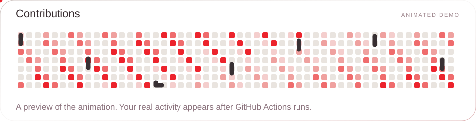</picture>
